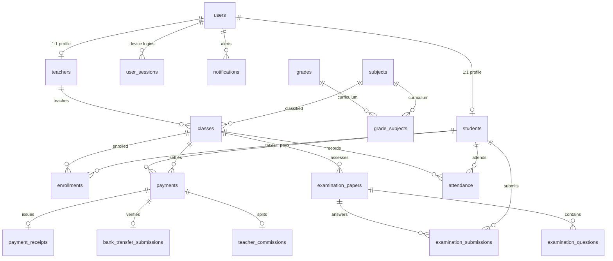

# EDU CLICK – MySQL 8.0 Relational Database Schema

**Database Engine**: MySQL 8.0 (InnoDB, `utf8mb4_unicode_ci`)  
**Total Normalized Tables**: 36

---

## 1. Table Catalog & Relationships

---

## 2. Table Directory

1. **`users`**: Central authentication table. Fields: `id`, `username`, `email`, `mobile`, `password_hash`, `role` (STUDENT, TEACHER, ADMIN), `is_active`, `preferred_language`.
2. **`students`**: Student academic and guardian registry. Fields: `id`, `user_id`, `registration_number` (`STU2026xxxx`), `full_name`, `date_of_birth`, `gender`, `parent_name`, `parent_mobile`, `address`, `district`, `grade` (1–13).
3. **`teachers`**: Instructor profile and compensation config. Fields: `id`, `user_id`, `teacher_id` (`TCH2026xxxx`), `full_name`, `qualifications`, `experience_years`, `bio`, `commission_percentage` (default 70%), `rating`, `total_students`.
4. **`grades`**: National education stages (Grade 1 through 13).
5. **`subjects`**: Dynamic subjects managed by administrator.
6. **`grade_subjects`**: Many-to-many relationship mapping subjects to applicable grades.
7. **`teacher_subjects`**: Teacher authorizations per grade and subject.
8. **`classes`**: Scheduled learning units. Fields: `title`, `subject_id`, `grade`, `teacher_id`, `fee_lkr`, `is_free`, `capacity`, `enrolled_count`, `status`, `medium`, `day_of_week`, `start_time`, `end_time`, `class_type`, `external_link`.
9. **`class_schedules`**: Specific date session instances.
10. **`enrollments`**: Unique student-class pairings with active status.
11. **`payment_methods`**: Enabled payment channels (PayHere, Bank Transfer).
12. **`bank_accounts`**: Official company deposit accounts (BOC, Commercial Bank, HNB).
13. **`payments`**: Financial transactions. Fields: `student_id`, `class_id`, `amount_lkr`, `payment_method`, `status` (PENDING, APPROVED, REJECTED, REFUNDED), `transaction_id`.
14. **`payment_receipts`**: Official receipt identifiers and electronic verification records.
15. **`bank_transfer_submissions`**: Student slip uploads, reference numbers, deposit dates, verification status, and admin rejection notes.
16. **`payment_verifications`**: Admin action audit logs for payment verifications.
17. **`payment_gateway_transactions`**: PayHere raw responses, status codes, and order references.
18. **`payment_webhooks`**: Inbound gateway webhook payloads and cryptographic signatures.
19. **`teacher_commissions`**: Calculated earnings per class payment (70% Teacher, 30% Platform).
20. **`commission_payouts`**: Disbursed payouts to teachers.
21. **`live_class_sessions`**: Active WebRTC / LiveKit session rooms.
22. **`live_class_participants`**: Participant join and leave timestamps.
23. **`meeting_integrations`**: External Zoom, Google Meet, and MS Teams credentials.
24. **`examination_papers`**: Test instruments (Term 1, Term 2, Model, Past, Revision).
25. **`examination_questions`**: Questions, types (MCQ, True/False, Essay), options JSON, correct answers, and marks.
26. **`examination_submissions`**: Student answers and graded scores.
27. **`examination_answers`**: Individual question responses.
28. **`examination_results`**: Percentage scores and letter grades (A, B, C, S, F).
29. **`attendance`**: Class session attendance records (PRESENT, ABSENT, LATE).
30. **`notifications`**: User notifications with types and read flags.
31. **`device_tokens`**: FCM / APNs device push tokens.
32. **`user_sessions`**: Active cross-device logins, refresh token hashes, IP addresses, and revocation status.
33. **`user_devices`**: Device hardware metadata.
34. **`otp_verifications`**: 6-digit SMS OTP verification codes with expiration timestamps.
35. **`system_settings`**: Global platform key-value configurations.
36. **`audit_logs`**: Security activity logs.
